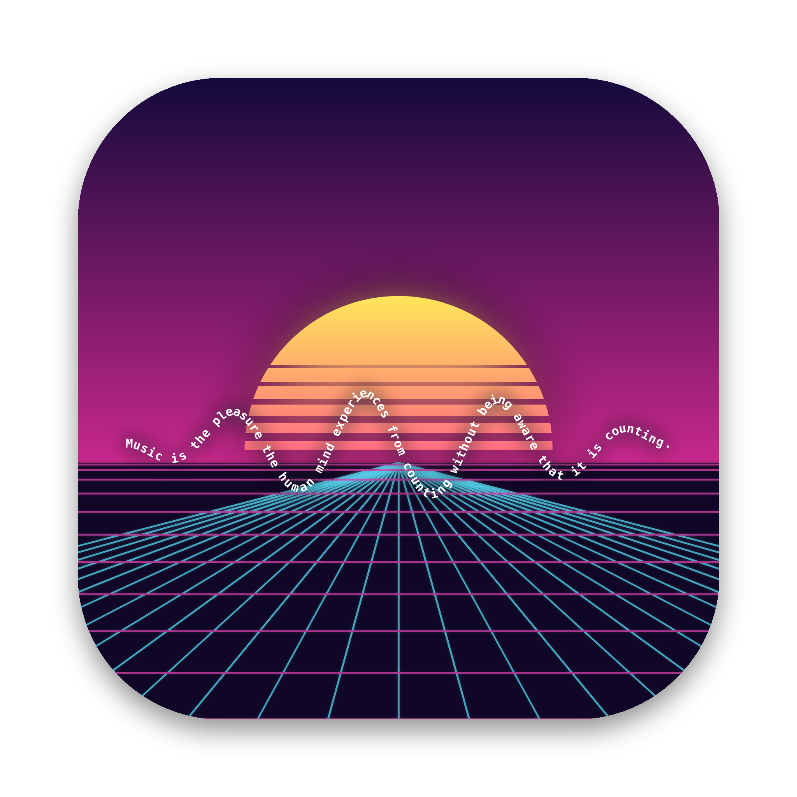
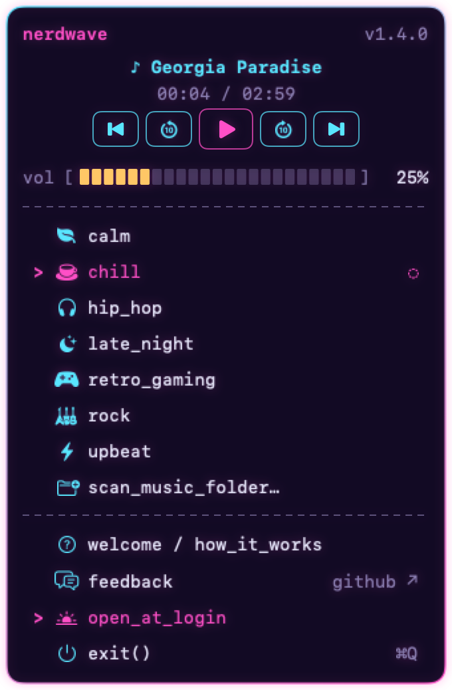
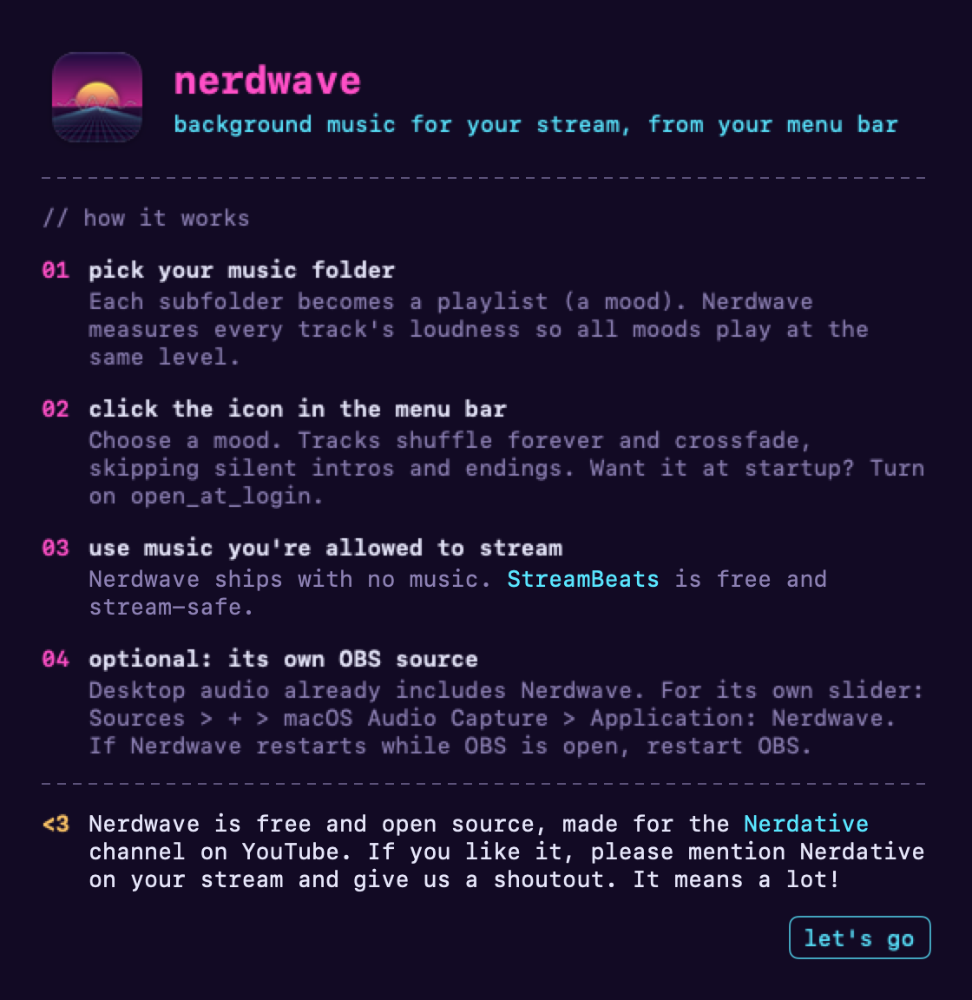

<p align="center"></p>

# Nerdwave

**Background music for your stream, from your Mac's menu bar.**

Nerdwave is a small, free, open-source macOS menu bar player built for streamers. Point it at a folder of
stream-safe music, pick a mood, and it plays forever: shuffled, crossfaded, and balanced so every mood sits
at the same level under your voice. Because it is its own app, OBS can capture just the music and nothing
else from your Mac.

Made for the [Nerdative](https://www.youtube.com/@nerdative) channel on YouTube. If you like it, a shoutout
on your stream means a lot.

<p align="center">
  
  &nbsp;&nbsp;
  
</p>

## Features

- **Menu bar only.** No Dock icon, no window in your way. Click the icon for a terminal-style panel.
- **Moods from folders.** Each subfolder of your music folder becomes a playlist, with an icon picked from its
  name ("Boss Fights" gets a flame, "Lofi Study" a coffee cup, "Jazz Nights" a jazz note...). Rescan any time.
- **Balanced loudness.** Nerdwave measures every track (EBU R128 / ITU-R BS.1770, the broadcast standard)
  and gives each mood a weight so switching moods never jumps in volume.
- **Endless, smooth playback.** Shuffle that reshuffles every pass (no repeats across the boundary), and a
  3 second crossfade that starts before a track's silent ending and skips silent intros (silence of up to
  15 seconds at either end is detected).
- **Transport controls.** Back, rewind 10 s, play/pause, forward 10 s, next. Back walks through the last
  1000 tracks, even across moods.
- **Media keys.** Play/pause, next and previous work from the keyboard and Control Center, which also shows the
  track. macOS sends those keys to whichever app last started playing, so a video you start later takes them, and
  playing or skipping in Nerdwave takes them back.
- **Remembers things.** Volume (default 25%), the last mood (ready to play, never auto-plays at login),
  and your history survive restarts.
- **Open at login** toggle (off by default), and a `feedback` link straight to GitHub issues.

## Download

Grab the latest **Nerdwave-x.y.z.zip** from [Releases](https://github.com/grumpitect/nerdwave/releases/latest),
unzip it, move **Nerdwave.app** to Applications and open it.

Nerdwave is free and not notarized by Apple, so the first time macOS says it can't verify the developer. Open
**System Settings > Privacy & Security**, scroll down and click **Open Anyway**. You only need to do this once.

## Requirements

- macOS 14 Sonoma or later (developed and tested on Apple Silicon; Intel builds are untested)
- Xcode or the Xcode Command Line Tools (Swift 5.9+) to build from source

## Build from source

```bash
git clone https://github.com/grumpitect/nerdwave.git
cd nerdwave
./build.sh
```

`build.sh` runs the tests, builds `Nerdwave.app`, and installs it to `~/Applications`. Open it from there;
a welcome screen explains the rest. Maintainers publish a release with `./release.sh` (patch bump by default;
`minor`, `major` or an exact `X.Y.Z` also work).

**Keep permissions across rebuilds (optional, for developers).** macOS remembers folder access per code
signature. Ad hoc builds get a new signature every time, so macOS may ask again (or quietly block your music
folder) after each rebuild. A free self-signed certificate fixes that:

1. Keychain Access > Certificate Assistant > Create a Certificate
2. Name `Nerdwave Signing`, Identity Type **Self Signed Root**, Certificate Type **Code Signing**
3. Build with `SIGN_IDENTITY="Nerdwave Signing" ./build.sh`

## Getting music you're allowed to stream

Nerdwave ships with **no music**. Use music that is cleared for streaming, for example
[StreamBeats](https://www.streambeats.com) (free, made for streamers, downloadable from
[their Bandcamp](https://streambeats.bandcamp.com)).

Organize it like this, one folder per mood:

```
My Stream Music/
├── Chill/
│   ├── Album A/01 Track.mp3
│   └── Album B/...
├── Hip-Hop/
└── Retro Gaming/
```

Then click **scan_music_folder…** in the panel and choose `My Stream Music`. Supported formats: mp3, m4a, aac,
wav, aiff, flac, caf.

## Note: capturing only Nerdwave in OBS (optional)

If your stream already captures your Mac's desktop audio, Nerdwave's music is included and there is nothing to
set up. If you'd rather give the music its own source (its own slider, filters, or keeping other Mac sounds off
stream), add **Sources > + > macOS Audio Capture** with Method **Application Audio Capture** and Application
**Nerdwave**. OBS builds its list of apps when it starts, so if Nerdwave was quit and reopened while OBS was
running, restart OBS (or open the source's properties) so it re-attaches.

## How playlists work

Playlists live in `~/Library/Application Support/Nerdwave/Playlists/` as standard `.m3u` files, and Nerdwave
reads that folder every time it starts and every time you open the panel. Scanning writes one file per mood
(replacing files with the same name, leaving others alone). Each file has a weight line that other players
treat as a comment:

```
#EXTM3U
#WEIGHT: 90%
#LOUDNESS: -12.00 LUFS
#EXTINF:180,Track Name
/Users/you/Music/My Stream Music/Chill/Album A/01 Track Name.mp3
```

`#LOUDNESS:` is the mood's median track loudness. After every scan Nerdwave rebalances **all** playlists from
these values, so moods from different scans match. The quietest mood gets 100% and louder moods are turned
down. You can edit `#WEIGHT:` by hand (the panel picks it up when it opens; the next scan recalculates it). Volume follows VLC's cubic curve, so 25% in Nerdwave
sounds like 25% in VLC.

## Command line

```bash
~/Applications/Nerdwave.app/Contents/MacOS/Nerdwave --scan "/path/to/music"   # build playlists, print weights, quit
~/Applications/Nerdwave.app/Contents/MacOS/Nerdwave --play Chill              # start a mood (handy for a Stream Deck)
~/Applications/Nerdwave.app/Contents/MacOS/Nerdwave --snapshot panel.png      # render the panel to an image
```

## Development

```bash
swift test      # 52 tests: playlists, scanning, icons, loudness (incl. the EBU -23 LUFS reference tone),
                # weights and rebalancing, shuffle, history, crossfade, seek, error handling,
                # menu layout, and real audio playback (muted, so tests are silent; they need an audio output device)
swift build
```

- `Sources/MusicCore`: everything testable (player, crossfade engine, loudness meter, scanner, menu model).
- `Sources/App`: the AppKit + SwiftUI menu bar app.
- `Tools/make_icon.py`: regenerates the icon (`pip install pillow numpy`, then `python3 Tools/make_icon.py Resources`;
  `python3 Tools/make_icon.py --png docs/nerdwave-icon.png 2048` renders the large README version).

Two macOS details worth knowing if you hack on it: OBS's per-app capture only lists apps that own a window,
so Nerdwave keeps an invisible 1x1 window; and playback uses `AVAudioEngine` so audio is rendered inside the
app's own process, which is what OBS captures.

## Feedback

Found a bug or have an idea? Click **feedback** in the panel, or
[open an issue](https://github.com/grumpitect/nerdwave/issues/new/choose).

## License

[MIT](LICENSE). The icon's quote is a common English paraphrase of Gottfried Wilhelm Leibniz (letter to Christian
Goldbach, 1712): "Music is the pleasure the human mind experiences from counting without being aware that it is
counting."
